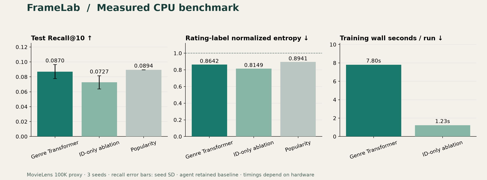
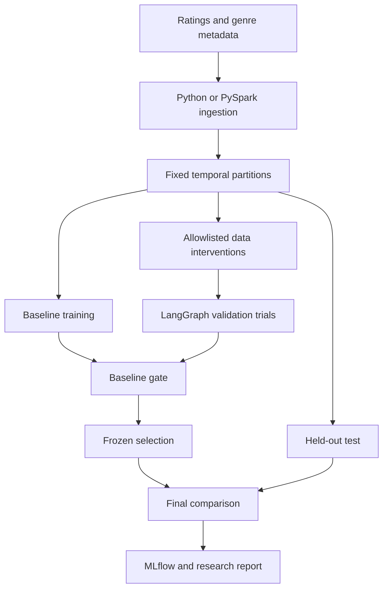

# FrameLab — Video Recommendation Research & Bounded Improvement Agent

**Train a recommender. Challenge it with controlled data changes. Keep the evidence—even when a change fails.**

A reproducible research portfolio project combining **PyTorch, Transformers, PySpark,
MLflow, Optuna and LangGraph**. It studies recommendation methods on MovieLens 100K,
a public **movie-rating proxy for video discovery**. It does not claim to model
short-video watch time, online CTR, or Meta-scale serving.

[Research report](reports/research-report.md) · [Measured results](reports/results.json) ·
[Protocol](docs/protocol.md) · [Architecture](docs/architecture.md) ·
[Dataset card](docs/data-card.md) · [GitHub setup](docs/github-setup.md)



## What this project demonstrates

- A two-tower recommender with user/item embeddings, biases and a trainable genre Transformer.
- Full-catalog **Recall@10**, **NDCG@10**, and binary rating-label **normalized entropy**.
- Global temporal splitting, train-only ID maps, seen-item masking and split integrity hashes.
- A LangGraph controller that tests exactly three bounded training-data weighting changes.
- A fixed baseline gate, a frozen decision before test evaluation, and baseline retention on failure.
- Three paired random seeds, a no-content ablation, bootstrap intervals and measured training costs.
- MLflow parameters, loss curves, validation/test metrics and CPU cost tracking.
- Optional PySpark ingestion/validation/Parquet and a separate bounded Optuna tuning study.
- A portable HTML results viewer, unit/integration tests, CI and a source/wheel release workflow.

**No paid API, LLM key, model download or GPU is required.** The small Transformer is
initialized randomly and trained from scratch using genre IDs. The agent is a
**deterministic experimental controller**, not an LLM that writes or executes code.

## Reference findings

The bundled run uses eight epochs and seeds 42, 43 and 44. The model is compared
with training-popularity ranking and a no-content version without the Transformer.

| Model | Test Recall@10, mean ± seed SD | Test normalized entropy, mean ↓ |
|---|---:|---:|
| Two-tower + genre Transformer | 0.0870 ± 0.0094 | 0.8642 |
| No-content ablation | 0.0727 ± 0.0088 | 0.8149 |
| Popularity | 0.0894 | 0.8941 |

None of the three training-data interventions passed the validation gate. The agent
therefore **retained the baseline**. The popularity baseline slightly exceeds the
neural model's mean Recall@10; the no-content model has better normalized entropy
and lower training cost. These are useful negative and mixed findings, not a claim
that adding a Transformer or an agent always improves recommendations.

**Coverage matters:** the global split retains 79,999 training, 1,520 validation and
1,344 test interactions after warm-start filtering. It excludes 86.56% of the raw
test partition because of cold-start users/items. Results apply only to the retained
population; only **52 positive test users** contribute to Recall@10. Counts are in
`reports/results.json`.

## Architecture



PySpark validates, aggregates and writes Parquet, then collects this small benchmark
for CPU training. It is not a distributed neural training implementation.

## Quick start — Windows PowerShell

Install Python **3.12**. Extract this repo and open PowerShell in the folder containing
`pyproject.toml`. No administrator shell or virtual-environment activation is needed.

```powershell
py -3.12 -m venv .venv
.\.venv\Scripts\python.exe -m pip install torch==2.6.0 --index-url https://download.pytorch.org/whl/cpu
.\.venv\Scripts\python.exe -m pip install -r requirements.lock
.\.venv\Scripts\python.exe -m pip install --no-deps --no-build-isolation -e .
.\.venv\Scripts\python.exe -m pip check
.\.venv\Scripts\python.exe -m pytest -q
```

Read the [GroupLens usage terms](https://files.grouplens.org/datasets/movielens/ml-100k-README.txt)
first. The following flag records your choice to download the data for research use:

```powershell
.\.venv\Scripts\python.exe -m reclab.cli download --accept-license
.\.venv\Scripts\python.exe -m reclab.cli prepare
.\.venv\Scripts\python.exe -m reclab.cli experiment --output runs/my-research
Start-Process .\runs\my-research\index.html
```

The experiment uses CPU with two threads. Initial dependency downloads are larger
than the dataset; allow several GB of disk space. Local timing depends on your machine.
Output paths must be new: use `runs/my-research-2` for another run.

For a quick smoke run, use two epochs and one seed; its numbers are not comparable
to the bundled eight-epoch reference:

```powershell
.\.venv\Scripts\python.exe -m reclab.cli experiment --epochs 2 --seeds 42 --output runs/smoke
```

**See the packaged results immediately without training:** open `reports/index.html`.
GitHub displays the Markdown report directly; download HTML to view it locally.

## Linux setup

```bash
python3.12 -m venv .venv
.venv/bin/python -m pip install torch==2.6.0 --index-url https://download.pytorch.org/whl/cpu
.venv/bin/python -m pip install -r requirements.lock
.venv/bin/python -m pip install --no-deps --no-build-isolation -e .
.venv/bin/python -m reclab.cli download --accept-license
.venv/bin/python -m reclab.cli prepare
.venv/bin/python -m reclab.cli experiment --output runs/my-research
```

## MLflow

After running an experiment, use its local tracking store:

```powershell
.\.venv\Scripts\mlflow.exe ui --backend-store-uri ./runs/my-research/mlruns --host 127.0.0.1 --port 5000
```

Open `http://127.0.0.1:5000`. Each training run includes its seed, split hash, model
config, loss curve, validation metrics and costs. Only baseline, selected policy
and the predefined ablation receive test metrics. Metrics replace `@` with `_at_`
in MLflow names. The public ZIP does not include the local MLflow store.

## Optional Optuna study

```powershell
.\.venv\Scripts\python.exe -m reclab.cli tune --trials 2 --output runs/tuning
```

Two to eight trials can explore embedding dimension and learning rate using
validation only (the CLI also permits a one-trial smoke run). This study is separate:
its best parameters never silently replace the fixed benchmark. The bundled
[exploratory trial log](reports/tuning.json) includes per-trial training costs.

## Optional PySpark preprocessing

Use Java 17 and install the pinned extra:

```powershell
.\.venv\Scripts\python.exe -m pip install pyspark==3.5.5
.\.venv\Scripts\python.exe -m reclab.cli prepare --engine spark
```

For Windows-specific Hadoop filesystem errors, use WSL/Linux for this optional path.
The default Python path avoids Java entirely. Spark writes a row-count profile and
Parquet under your local data folder. [The parity report](reports/spark-parity.json)
records matching hashes between both paths on the real 100K dataset.

Run the opt-in synthetic Spark test in Linux/WSL:

```bash
RUN_SPARK_TESTS=1 SPARK_LOCAL_IP=127.0.0.1 .venv/bin/python -m pytest tests/test_spark.py -q
```

## Agent boundaries

| Allowed change | Bound | Training-only source |
|---|---|---|
| Recency weighting | 0.8–1.2 | Training timestamps |
| Tail-item weighting | 1.0 or 1.2 | Training item counts |
| Ambiguous rating weighting | 1.0 or 0.8 | Rating equals 3 |

A candidate must improve validation Recall@10 by at least **0.001 absolute** while
keeping NE at most **1.02 × baseline NE**. All candidates start from the same seed,
optimizer settings and immutable training rows. No rows or labels are added/deleted.
Three trials are permitted; the best qualifying candidate wins. Otherwise, baseline
is retained. The agent does not alter model code, test data or deployment state.

The fixed proposal agenda is deliberately simple. This repo demonstrates safe
experimental control and reproducibility; it does not establish language-agent
reasoning ability or unrestricted autonomous research.

## Metric definitions

- **Recall@K:** macro average of `hits / held-out positives` over retained users
  with at least one positive. Rank over the full training catalog, excluding earlier
  observed interactions. Test masks train plus validation history.
- **NDCG@K:** binary relevance with logarithmic position discounts and ideal normalization.
- **Normalized entropy:** mean binary cross-entropy divided by the entropy of the
  held-out positive-label prevalence. Lower is better; 1 is the constant predictor
  using that partition's prevalence. Single-class partitions raise an error.

These labels are explicit ratings, not clicks. Do not describe this metric as
production CTR entropy, use sampled negatives to inflate ranking scores, or omit
cold-start exclusions when presenting the results.

## Tests and reproducibility

```powershell
.\.venv\Scripts\python.exe -m ruff check .
.\.venv\Scripts\python.exe -m ruff format --check .
.\.venv\Scripts\python.exe -m pytest -q
.\.venv\Scripts\python.exe -m build --wheel --no-isolation
```

Tests cover known metric answers, temporal boundaries, timestamp ties, duplicates,
cold-start exclusions, checksums, bounded weights, baseline retention, selected-policy
gating, deterministic training, and freezing decisions before test access. An end-to-end
synthetic experiment tests MLflow and report generation without external data.

CI runs Python 3.12 on Linux and Windows, plus a separate Linux/Java17 Spark job.
Local verification details are in [validation.md](docs/validation.md). Equal seeds
are reproducible in the tested environment, not guaranteed bitwise across platforms.

## Docker (optional CPU training)

```powershell
docker build -t framelab:local .
docker volume create framelab-data
docker volume create framelab-runs
docker run --rm -v framelab-data:/app/data framelab:local download --accept-license
docker run --rm -v framelab-data:/app/data framelab:local prepare
docker run --rm -v framelab-data:/app/data -v framelab-runs:/app/runs framelab:local experiment --output runs/docker-research
```

This optional image uses Python ingestion, not Spark. It saves output in the named
volume. Native Python is the verified default; see validation notes for Docker status.

## Repository guide

| Path | Purpose |
|---|---|
| `reclab/data.py` | Download, schema validation, time split and digests |
| `reclab/model.py`, `train.py` | Neural model, fixed training and popularity comparator |
| `reclab/metrics.py` | Recall, NDCG, NE and paired bootstrap |
| `reclab/agent.py` | Bounded LangGraph proposal/trial/gate loop |
| `reclab/experiment.py` | MLflow, frozen selection, final evaluation, Optuna |
| `reports/` | Real aggregate results, decision audit, report and benchmark plot |
| `docs/` | Protocol, dataset card, architecture, operations and GitHub setup |
| `tests/` | Synthetic regression and integration tests |

## Research scope and next questions

This portfolio study demonstrates research discipline, not PhD-level novelty or
Meta affiliation. Important next experiments include capacity-matched encoders,
better cold-start treatment, multiple temporal windows and a licensed video-exposure
dataset. Watch-time or randomized impression data would be needed for stronger
video-specific and causal conclusions. Report unsuccessful proposals honestly.

## License and attribution

Code: MIT. MovieLens is governed by its own research-use terms. Raw ratings,
metadata and learned checkpoints are not bundled or licensed by this repository.

F. Maxwell Harper and Joseph A. Konstan. 2015. *The MovieLens Datasets: History and
Context*. ACM Transactions on Interactive Intelligent Systems 5(4), Article 19.
[DOI: 10.1145/2827872](https://doi.org/10.1145/2827872).
