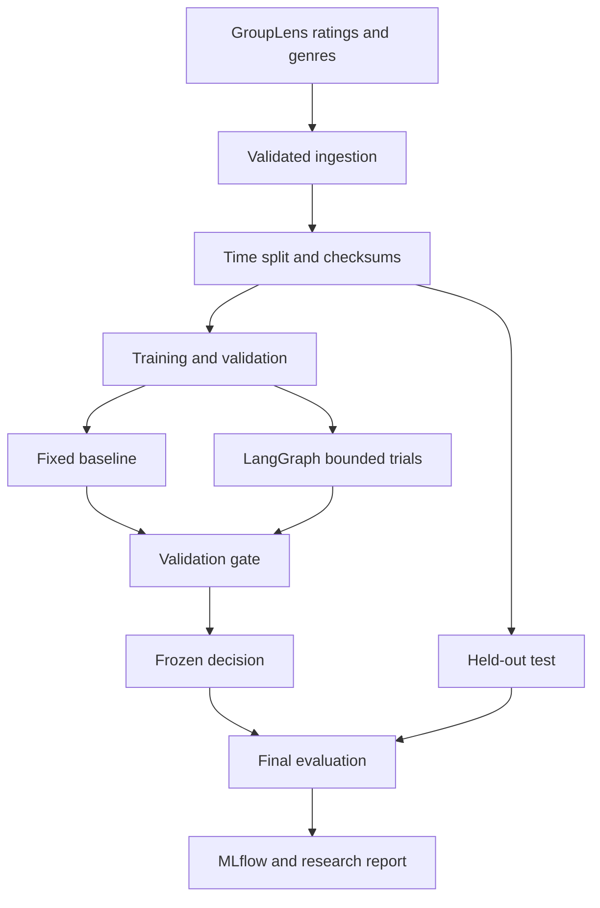

# Architecture and trust boundaries

Python ingestion is the default for a small CPU benchmark. The optional PySpark
path validates the schema, rejects duplicates, aggregates row/user/item counts,
and writes Parquet. Both paths use the same canonical in-memory splitter and
hash protocol. The pilot collects 100K interactions for CPU training: it does
not claim distributed neural training or large-scale Spark scalability.

The two-tower model scores all training-catalog items. There is no serving API,
video playback, embedding index, or recommendation chatbot in this research repo.
`reports/index.html` is a portable results viewer; MLflow supplies experiment browsing.

The controller has an allowlist and a fixed three-trial loop. It receives only
training rows and a validation evaluator. It cannot issue shell commands, run
model-generated SQL, synthesize labels, change the architecture, or deploy models.
It is a deterministic agentic workflow, not an LLM reasoning benchmark.
